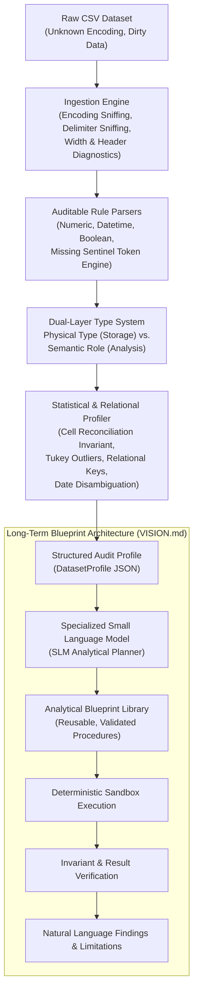

# AI CSV Data Analyst

A deterministic, local-first CSV ingestion, data-integrity, and statistical profiling engine built as the foundation for an autonomous, blueprint-driven AI data analyst.

[](https://python.org)
[-success.svg)](pyproject.toml)
[](LICENSE)
[](tests/)

---

## 1. Overview & Project Philosophy

The **AI CSV Data Analyst** project bridges the gap between raw, messy tabular data and trustworthy autonomous analytical reasoning. 

While large language models (LLMs) can write code, unconstrained code generation over unfamiliar datasets frequently causes subtle data distortions, silent type coercion, hallucinated relationships, and heavy computational latency. The AI CSV Data Analyst replaces guesswork with a **two-tier architecture**:

1. **A Deterministic Data Foundation (Core Engine)**: A zero-external-dependency Python engine that parses, validates, reconciles, and profiles CSV files with mathematical precision, auditable rules, and comprehensive diagnostics.
2. **A Blueprint-Driven Orchestration Layer (SLM Vision)**: A specialized small language model (SLM) that translates natural-language questions into structured plans, retrieves reusable, pre-validated analytical blueprints, invokes trusted deterministic execution, and explains the findings in plain language.



> [!NOTE]
> The core profiling and data-integrity engine requires **zero external runtime dependencies**—it executes entirely on the Python 3.10+ Standard Library (`csv`, `math`, `statistics`, `datetime`, `re`, `json`, `dataclasses`, `pathlib`).

---

## 2. Core Subsystems & Architecture

### A. Streamed Ingestion & Structural Diagnostics ([`loader.py`](file:///home/akshit/ai-csv-data-analyst/src/ai_csv_data_analyst/loader.py), [`diagnostics.py`](file:///home/akshit/ai-csv-data-analyst/src/ai_csv_data_analyst/diagnostics.py))
- **File Classification**: Differentiates empty 0-byte files, whitespace-only files, header-only files, and valid data tables.
- **Robust Encoding Sniffing**: Non-redundant multi-encoding probing across `utf-8-sig`, `utf-8`, `latin-1`, `cp1252`, and `iso-8859-1` with automatic UTF-8 byte order mark (BOM) handling.
- **Delimiter Auto-Detection**: Probes common candidate delimiters (`,`, `;`, `\t`, `|`) with fallback guarantees.
- **Strict vs. Tolerant Modes**:
  - `strict_mode=False` (default): Preserves malformed records, pads field deficits with missing indicators, captures surplus fields into structured diagnostics, and retains the complete original row count.
  - `strict_mode=True`: Halts immediately upon encountering width anomalies with actionable line-numbered [`LoadError`](file:///home/akshit/ai-csv-data-analyst/src/ai_csv_data_analyst/loader.py#L32) diagnostics.
- **Header Analysis**: Sanitizes leading/trailing whitespace, detects duplicate and blank headers, and resolves header collisions deterministically without silent column overwrites.

### B. Auditable Rule-Based Parsing ([`parser.py`](file:///home/akshit/ai-csv-data-analyst/src/ai_csv_data_analyst/parser.py))
Every parsed cell returns a [`ParseResult`](file:///home/akshit/ai-csv-data-analyst/src/ai_csv_data_analyst/parser.py#L21) containing whether it was valid, the raw string, the parsed object, the exact rule applied, and any detected ambiguity:
- **Numerics**: Integers, standard floats, exponential notations, currency prefixes/suffixes (`₹`, `$`, `€`, `£`, `¥`), percentage strings (`%`), thousand-separator variants (`1,234.56` vs. `1.234,56`), and ambiguous comma decimals (`12,5`).
- **Non-Finite Number Rejection**: `NaN`, `+Inf`, `-Inf`, and `Infinity` are classified explicitly as `invalid` values—they are **never** silently coerced into zeros, missing tokens, or valid floats.
- **Datetimes**: ISO 8601 strings (`YYYY-MM-DD`, `YYYY-MM-DDTHH:MM:SS`), slash/dash separated dates (`DD/MM/YYYY`, `MM/DD/YYYY`), calendar validity checks (e.g. rejecting February 30), and format ambiguity detection.
- **Booleans**: Auditable parsing of boolean variants (`true`/`false`, `yes`/`no`, `1`/`0`, `t`/`f`).
- **Month-Year Tokens**: Standalone parsing of period tokens like `Feb-2019`, `February 2019`, or `2019-02` for contextual cross-referencing.

### C. Dual-Layer Type System: Physical Types vs. Semantic Roles ([`types_and_roles.py`](file:///home/akshit/ai-csv-data-analyst/src/ai_csv_data_analyst/types_and_roles.py))
Traditional profiling tools conflate the storage type of a column with its analytical role. AI CSV Data Analyst explicitly separates them:

| Physical Type (`PhysicalType`) | Semantic Role (`SemanticRole`) | Example Column | Analytical Impact |
| :--- | :--- | :--- | :--- |
| `INTEGER` | `IDENTIFIER` | `Patient_ID`, `S_No`, `Zip_Code` | **Suppresses** mean, std dev, and quartiles; tracks candidate key viability |
| `INTEGER` | `MEASURE` | `Heart_Rate`, `Revenue`, `Age` | **Computes** mean, median, std dev, quartiles, and Tukey IQR outlier candidates |
| `STRING` | `IDENTIFIER` | `MRD_No`, `UUID`, `SKU` | Evaluates repeated visits, uniqueness ratio, and entity linkage |
| `STRING` | `CATEGORY` | `Gender`, `Department`, `Tier` | Tracks cardinality ratio and frequency distributions |
| `DATETIME` | `TIMESTAMP` | `Admission_Date`, `Created_At` | Computes temporal span, coverage days, and chronological ordering |
| `STRING` | `URL` | `image_url`, `product_link` | Validates URI schemes; checks for candidate resource keys |
| `BOOLEAN` | `BOOLEAN_FLAG` | `is_churned`, `has_insurance` | Evaluates class balance and binary distribution |

- **Heuristic Evidence**: Inspects sequential integer continuity (`is_sequential`), leading-zero formatting (e.g. `"00123"`), regex name matching (`_ID_NAME_RE`, `_TIME_NAME_RE`), and uniqueness ratios.

### D. Invariant Value Accounting & Statistical Profiler ([`profiler.py`](file:///home/akshit/ai-csv-data-analyst/src/ai_csv_data_analyst/profiler.py))
- **Mathematical Invariant Reconciliation**:
  Every column's cells are classified into mutually exclusive sets:
  $$N_{\text{source}} = N_{\text{valid}} + N_{\text{missing}} + N_{\text{invalid}} + N_{\text{unclassified}}$$
  where:
  $$N_{\text{missing}} = N_{\text{blank}} + N_{\text{sentinel}}$$
  The engine asserts `is_reconciled == True` across all columns.
- **Configurable Missing Tokens**: Global and per-column sentinel tokens (e.g. `NA`, `N/A`, `null`, `EMPTY`, `NILL`, `-`) distinguish configured sentinels from blank whitespace cells without altering the original strings.
- **Numeric Statistics & Tukey IQR Outliers**:
  - Bessel-corrected sample standard deviation ($s = \sqrt{\frac{1}{N-1}\sum (x_i - \bar{x})^2}$).
  - Deterministic inclusive quantiles (Q1, Median, Q3).
  - Tukey boxplot outlier candidate boundaries:
    $$[\text{Q1} - 1.5 \times \text{IQR}, \quad \text{Q3} + 1.5 \times \text{IQR}]$$
    Candidates are surfaced for investigation rather than destructive auto-cleaning.
- **Context-Aware Datetime Resolution**:
  - Resolves ambiguous date formats (such as `03/04/2021`) by searching for unambiguous dates in the column, matching admission dates against explicit `month_year` columns, and enforcing chronological sanity (e.g. Discharge Date $\ge$ Admission Date).
  - If a column's dates remain ambiguous and lacks decisive context, the engine **withholds definitive min/max timestamps** (`definitive_min_date: None`) and issues an audit warning rather than guessing.
- **Relational Structure & Candidate Keys**:
  - Single-column candidate keys (100% unique values and 0 missing cells).
  - Bounded composite keys (combinations of 2 columns with uniqueness guarantees, bounded to prevent combinatorial explosion on wide tables).
  - Constant column detection.
- **Duplicate Row Metrics**:
  - Distinguishes **excess duplicate rows** (rows that would be removed by a unique deduplication pass: $\sum (c_i - 1)$) from **rows participating in duplicate groups** ($\sum c_i$ for $c_i > 1$).
- **Audit Provenance**:
  - Tracks package version, active git commit hash, resolved filesystem module path, python version, file SHA-256 fingerprint, timestamp, and effective configuration.

### E. Isolated SLM Decision-Testing Harness ([`experiments/llm_decision_testing/`](file:///home/akshit/ai-csv-data-analyst/experiments/llm_decision_testing/))
To evaluate how specialized small language models (such as `qwen3.5:0.8b` running locally via Ollama) interpret the structured JSON profiles produced by this engine, a strictly isolated experimentation environment is included:
- **Zero Impact on Production**: Treat all `src/`, `tests/`, and root project files as read-only.
- **Standard Library HTTP Client**: Communicates with OpenAI-compatible Ollama endpoints without external networking packages.
- **Deterministic Decision Schema**: Enforces strict JSON contracts, floating-point confidence intervals (`[0.0, 1.0]`), forbidden action penalties, and proper abstention when evidence is insufficient.
- **100% Test Suite Pass Rate**: Includes 17 unit tests verifying offline decision validation alongside an 8-case end-to-end evaluation suite.

---

## 3. Project Structure

```
ai-csv-data-analyst/
├── src/ai_csv_data_analyst/             # Core Engine (Zero external dependencies)
│   ├── __init__.py                      # Package entry point and public exports
│   ├── __main__.py                      # Command-line module runner
│   ├── app.py                           # CLI interface and terminal formatters
│   ├── config.py                        # Immutable configuration dataclasses (ProfilingConfig)
│   ├── diagnostics.py                   # Structural diagnostics and ColumnValueCounts models
│   ├── loader.py                        # Streamed CSV loading, encodings, header resolution
│   ├── parser.py                        # Auditable numeric, datetime, and boolean parsers
│   ├── profiler.py                      # Statistical profiling, Tukey IQR, relational analysis
│   └── types_and_roles.py               # PhysicalType vs SemanticRole inference engine
├── tests/                               # Core Verification Suite (88 pytest tests)
│   ├── test_app.py                      # CLI integration and help flag tests
│   ├── test_demo_data.py                # Real-world benchmark CSV tests
│   ├── test_hardened_cli.py             # CLI strict, encoding, and missing-token flag tests
│   ├── test_hardened_loader.py          # Encoding fallbacks, delimiter, width deficit/surplus tests
│   ├── test_loader.py                   # Basic CSV loading and error boundary tests
│   ├── test_profiler.py                 # Summary metrics, top-10 frequencies, deterministic sorting
│   ├── test_targeted_fixes.py           # Date ambiguity, identifier roles, sentinels, provenance
│   ├── test_types_and_profiling.py      # Physical vs semantic roles, Tukey outliers, relational keys
│   └── test_value_classification_and_parser.py # Invariant reconciliation, auditable parsing
├── experiments/                         # Isolated Experimental Environments
│   └── llm_decision_testing/            # Standalone Qwen 3.5 0.8B Decision-Testing Harness
│       ├── cases/                       # 8 test scenario specifications
│       ├── fixtures/                    # Pre-generated DatasetProfile fixtures
│       ├── prompts/                     # System prompts for structured analytical planning
│       ├── tests/                       # 17 standalone unit tests for schema validation
│       ├── decision_schema.py           # JSON validation schema and metric evaluators
│       ├── llm_client.py                # Stdlib HTTP client for Ollama / OpenAI endpoints
│       ├── profile_adapter.py           # Read-only adapter for main profiling engine
│       ├── run_experiment.py            # CLI test runner (--offline, --suite, --case)
│       └── README.md                    # Detailed documentation for LLM testing
├── demo_data/                           # Real-world benchmark datasets (read-only)
│   ├── amazon_extracted/                # Amazon sales dataset (currency symbols, long text)
│   └── ...                              # Boston Housing, Telco Churn, Credit Card, etc.
├── VISION.md                            # Architectural blueprint for the autonomous SLM analyst
├── pyproject.toml                       # Build configuration and optional dev dependencies
├── requirements.txt                     # Dev dependencies pin
└── README.md                            # Complete project guide and reference
```

---

## 4. Installation & Setup

### Requirements
- Python **3.10** or higher
- Linux, macOS, or Windows

### Step 1: Clone the Repository
```bash
git clone https://github.com/Akshit-Akshit/ai-csv-data-analyst.git
cd ai-csv-data-analyst
```

### Step 2: Create a Virtual Environment
```bash
python3 -m venv .venv
source .venv/bin/activate  # On Windows: .venv\Scripts\activate
```

### Step 3: Install the Package

**Core Engine (No external runtime packages):**
```bash
pip install -e "."
```

**With Development & Testing Dependencies (`pytest`):**
```bash
pip install -e ".[dev]"
```

---

## 5. Command-Line Interface (CLI)

The CLI can be invoked using either `ai-csv-data-analyst` or `python -m ai_csv_data_analyst`.

### CLI Arguments & Options

| Flag | Parameter | Description |
| :--- | :--- | :--- |
| `<csv_file>` | File Path | **Required**. Path to the CSV file to analyze. |
| `--json` | Flag | Output full, structured profile as machine-readable JSON. |
| `--validate` | Flag | Fast structural validation only (checks encoding, headers, width without computing statistics). |
| `--strict` | Flag | Enforces strict validation: raises an error on surplus/deficit record width anomalies. |
| `--tolerant` | Flag | **Default**. Tolerates record width issues; logs them as structural diagnostics. |
| `--delimiter` | `<delim>` | Specify field delimiter (e.g. `,`, `;`, `\t`, `\|`) or `'auto'` for sniffing. Default: `,`. |
| `--encoding` | `<enc>` | Force an encoding (e.g. `utf-8`, `latin-1`, `cp1252`). Default: auto-sniff with fallbacks. |
| `--missing-tokens` | `<t1,t2,...>` | Comma-separated global missing-value tokens (e.g. `NA,N/A,null,EMPTY,-`). |
| `--col-missing-tokens`| `<col:t1,t2;...>` | Per-column missing-value tokens (e.g. `Age:999,NA;Income:-1`). |
| `--help`, `-h` | Flag | Display CLI options and usage instructions. |

### CLI Usage Examples

```bash
# 1. Standard text profiling summary to terminal
python -m ai_csv_data_analyst demo_data/amazon_extracted/amazon.csv

# 2. Generate complete machine-readable JSON profile
python -m ai_csv_data_analyst demo_data/amazon_extracted/amazon.csv --json > profile.json

# 3. Quick structural validation
python -m ai_csv_data_analyst demo_data/amazon_extracted/amazon.csv --validate

# 4. Strict structural check (fails on row-width discrepancies)
python -m ai_csv_data_analyst data.csv --strict --validate

# 5. Auto-sniff delimiter with custom missing sentinel tokens
python -m ai_csv_data_analyst sales.csv --delimiter auto --missing-tokens "NA,null,UNKNOWN,-" --json

# 6. Column-specific missing token overrides
python -m ai_csv_data_analyst survey.csv --col-missing-tokens "age:999,NA;income:None,MISSING"
```

---

## 6. Python API Reference

The package exposes a clean, modular Python API:

```python
from pathlib import Path
from ai_csv_data_analyst import (
    load_csv,
    profile_csv,
    ProfilingConfig,
    infer_column_type_and_role,
    parse_numeric_auditable,
)

# 1. Custom Profiling Configuration
config = ProfilingConfig(
    strict_mode=False,
    missing_tokens=("NA", "N/A", "null", "EMPTY"),
    per_column_missing_tokens={"salary": ("999999", "NILL")},
    iqr_outlier_factor=1.5,
)

# 2. Ingest and Validate
loaded = load_csv("customers.csv", config=config)
print(f"Loaded {loaded.row_count} rows across {loaded.column_count} columns.")
for diag in loaded.structural_diagnostics:
    print(f"[{diag.severity.value}] Line {diag.line_number}: {diag.message}")

# 3. Profile Dataset
profile = profile_csv("customers.csv", config=config)

# Overview metrics
print(f"Duplicate rows (excess): {profile.overview['excess_duplicate_rows']}")
print(f"Unique rows: {profile.overview['unique_rows']}")

# Column-level inspection
for col_name, stats in profile.column_profiles.items():
    print(f"\n--- Column: {col_name} ---")
    print(f"Physical Type : {stats.physical_type}")
    print(f"Semantic Role : {stats.semantic_role} (Confidence: {stats.type_confidence:.2f})")
    
    # Invariant classification counts
    if stats.value_counts:
        print(f"Cells: {stats.value_counts.source_cell_count} total | "
              f"{stats.value_counts.valid_count} valid | "
              f"{stats.value_counts.missing_count} missing ({stats.value_counts.blank_missing_count} blank, {stats.value_counts.sentinel_missing_count} sentinel)")
        assert stats.value_counts.is_reconciled
        
    # Semantic measures get numeric stats and outlier bounds
    if stats.numeric_stats:
        print(f"Mean: {stats.numeric_stats['mean']:.2f}, StdDev: {stats.numeric_stats['std_dev']:.2f}")
        print(f"IQR Outliers: {stats.outlier_stats['candidate_count']} candidates")
        
    # Identifiers suppress measure stats to avoid invalid mathematical operations
    if stats.identifier_stats:
        print(f"Candidate Key: {stats.identifier_stats['is_candidate_key']}, Sequential: {stats.identifier_stats['is_sequential']}")

# Relational Structure
print("\nRelational Keys Detected:")
print(f"Single Keys: {profile.relational_analysis['candidate_single_keys']}")
print(f"Composite Keys: {profile.relational_analysis['candidate_composite_keys']}")
```

---

## 7. JSON Output Schema Specification

When executed with `--json` or exported via `profile.to_dict()`, the engine emits the following comprehensive schema:

```json
{
  "file_path": "demo_data/amazon_extracted/amazon.csv",
  "row_count": 1465,
  "column_count": 16,
  "headers": ["product_id", "product_name", "discounted_price", "..."],
  "overview": {
    "rows": 1465,
    "columns": 16,
    "headers": ["product_id", "product_name", "..."],
    "numeric_columns": 5,
    "categorical_columns": 1,
    "text_columns": 10,
    "duplicate_rows": 0,
    "excess_duplicate_rows": 0,
    "rows_in_duplicate_groups": 0,
    "unique_rows": 1465,
    "total_size_bytes": 4744481,
    "file_type": "data_csv",
    "package_version": "0.1.0",
    "module_path": "/home/.../src/ai_csv_data_analyst/__init__.py"
  },
  "columns": {
    "discounted_price": {
      "inferred_type": "numeric",
      "physical_type": "float",
      "semantic_role": "measure",
      "type_confidence": 1.0,
      "type_evidence": {
        "numeric_ratio": 1.0,
        "is_sequential": false,
        "is_id_name": false
      },
      "missing_count": 0,
      "missing_percentage": 0.0,
      "valid_count": 1465,
      "distinct_count": 550,
      "has_high_cardinality": true,
      "is_empty": false,
      "value_classification": {
        "source_cell_count": 1465,
        "valid_count": 1465,
        "missing_count": 0,
        "blank_missing_count": 0,
        "sentinel_missing_count": 0,
        "invalid_count": 0,
        "unclassified_count": 0,
        "missing_rate": 0.0,
        "invalid_rate": 0.0,
        "is_reconciled": true
      },
      "numeric_stats": {
        "count": 1465,
        "mean": 3125.31,
        "median": 799.0,
        "std_dev": 6944.30,
        "min": 39.0,
        "max": 77990.0,
        "q1": 325.0,
        "q3": 1999.0,
        "range": 77951.0
      },
      "outlier_stats": {
        "method": "iqr",
        "factor": 1.5,
        "iqr": 1674.0,
        "lower_bound": -2186.0,
        "upper_bound": 4510.0,
        "candidate_count": 217,
        "candidate_rate": 0.148123,
        "note": "Outlier candidates for investigation; not automatically classified as errors"
      },
      "text_stats": {
        "distinct_count": 550,
        "most_frequent_values": [{"value": "₹199", "count": 53}],
        "min_length": 3,
        "max_length": 9,
        "mean_length": 4.95
      },
      "datetime_stats": null,
      "identifier_stats": null
    }
  },
  "summary": {
    "total_rows": 1465,
    "total_columns": 16,
    "total_missing_cells": 0,
    "missing_percentage": 0.0,
    "duplicate_row_count": 0,
    "rows_in_duplicate_groups": 0,
    "unique_rows": 1465
  },
  "quality_issues": [
    {
      "type": "outlier_candidates",
      "column": "discounted_price",
      "message": "Column 'discounted_price' has 217 candidate outliers based on 1.5x IQR"
    }
  ],
  "relational_analysis": {
    "candidate_single_keys": ["product_link"],
    "candidate_composite_keys": [],
    "constant_columns": [],
    "skipped_checks": null
  },
  "provenance": {
    "schema_version": "1.0.0",
    "package_version": "0.1.0",
    "module_path": "/home/.../src/ai_csv_data_analyst/__init__.py",
    "git_commit": "84c2d3e",
    "python_version": "3.14.4",
    "generated_at": "2026-10-22T08:04:51.069245",
    "file_fingerprint": "f2e0f2469250210171a5c05cd63c0a71c157d95c1ed4864d201d75d40070bfb8",
    "metrics_mode": "exact",
    "effective_config": {
      "strict_mode": false,
      "delimiter": ",",
      "encoding": "utf-8-sig",
      "missing_tokens": [],
      "per_column_missing_tokens": {},
      "decimal_separator": "."
    }
  },
  "structural_diagnostics": []
}
```

---

## 8. Verification & Testing

The project maintains extensive test coverage across unit tests, edge-case invariants, real-world demo datasets, and decision-testing suites.

### Running Core Tests (88 Tests)
```bash
# Run the complete test suite
pytest

# Run with verbose reporting
pytest -v

# Run targeted test suites
pytest tests/test_targeted_fixes.py -v
pytest tests/test_types_and_profiling.py -v
pytest tests/test_value_classification_and_parser.py -v
pytest tests/test_hardened_loader.py -v
```

### Running Isolated LLM Decision-Testing Suite (17 Tests)
```bash
# Run offline schema and semantic validator tests
pytest experiments/llm_decision_testing/tests/

# Run the offline test runner
python3 experiments/llm_decision_testing/run_experiment.py --offline

# Run the 8-case suite against local Ollama Qwen 3.5 0.8B (requires local Ollama server)
python3 experiments/llm_decision_testing/run_experiment.py --suite
```

---

## 9. Vision & Roadmap

For a comprehensive explanation of the long-term system architecture, consult [**`VISION.md`**](file:///home/akshit/ai-csv-data-analyst/VISION.md).

### Planned Milestones
- [x] **Phase 1: Deterministic CSV Ingestion & Structural Diagnostics** (Encoding fallbacks, width checks, header deduplication).
- [x] **Phase 2: Auditable Parsing & Dual-Layer Types** (Physical storage vs. semantic analytical roles, invariant reconciliation).
- [x] **Phase 3: Contextual Date Disambiguation & Relational Keys** (Admission/discharge alignment, Tukey IQR outlier candidates).
- [x] **Phase 4: Isolated LLM Decision-Testing Harness** (Benchmarking Qwen 3.5 0.8B on structured profile consumption).
- [ ] **Phase 5: Persistent Analytical Blueprint Library** (Versioned, parameterizable statistical procedures: distribution analysis, group comparisons, key detection).
- [ ] **Phase 6: Controlled Execution Sandbox** (Sandboxed Python execution layer verifying inputs, outputs, and sample size denominators).
- [ ] **Phase 7: SLM Fine-Tuning** (Instruction-tuning specialized SLMs on blueprint retrieval and non-destructive reasoning).

---

## 10. License & Contributing

- **License**: MIT License. See [LICENSE](LICENSE) for details.
- **Author**: Akshit ([GitHub](https://github.com/Akshit-Akshit))
- **Contributions**: Pull requests and issue reports are welcome. Please ensure that all `pytest` checks pass before submitting PRs.
